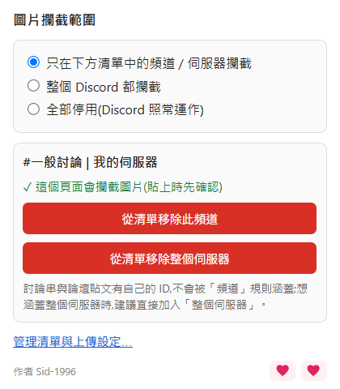
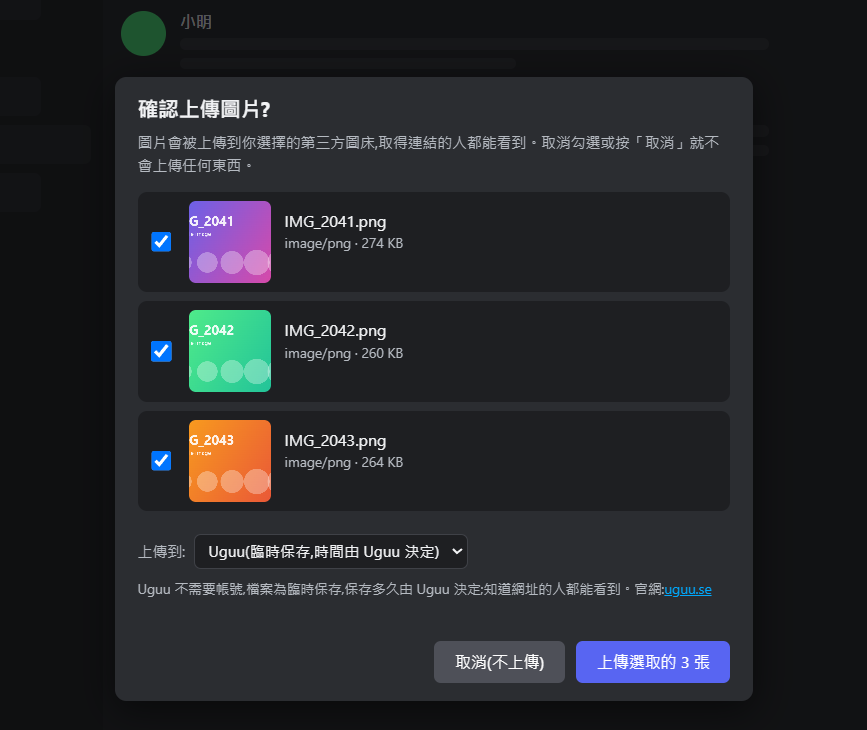
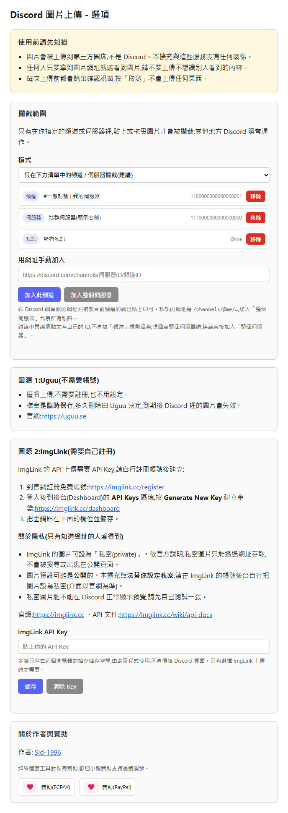

# Discord / Stoat 圖片轉網址(需確認)

在 Discord 或 Stoat 網頁版貼上(Ctrl+V)或拖曳圖片時,這個擴充功能**不會讓平台把圖片當成附件上傳**。
它做的是:先把圖片傳到第三方圖床換成一個 `https` 網址,再把**這串網址當成文字插回你原本的訊息輸入框**。
你按 Enter 送出的是「一個圖片連結」,不是圖片檔;Discord 會自動把連結顯示成可見的圖片預覽。

> 簡單說:**圖片 → 第三方圖床 → 取得網址 → 網址貼回輸入框 → 送出的是文字訊息**。
> 圖片檔本身不會進到 Discord 的附件,也不會被存進瀏覽器設定;只有在產生網址時短暫讀取,用完就釋放。瀏覽器裡只會留下「網址 + 檔名 + 時間」的上傳紀錄。

## 實際流程(為什麼不是直接上傳)

1. 在你加入清單的頻道貼上或拖入圖片
2. 圖片先被攔下,跳出確認視窗(可挑選要處理的圖片、要用的圖床)
3. 確認後,檔案被傳到 Uguu 或 ImgLink,取得一個公開的 `https` 網址
4. 擴充功能把**那串網址插入原本的訊息輸入框**,例如:`https://uguu.se/dl/abcd.png`
5. 你按 Enter 送出的其實是一則**文字訊息**,Discord 再把連結自動顯示成圖片預覽

也就是說:**圖床負責存檔,Discord 只收到網址**。如果圖床過期刪檔、或你/對方關閉了連結預覽,圖片就不會顯示,只會剩下一條網址。

## 適用情境

有些 Discord 伺服器或頻道預設關閉了圖片附件功能,或者成員沒有上傳附件的權限,這時貼上或拖曳圖片會失敗。本工具提供一個替代流程:先把圖片上傳到圖床換成網址,再把網址當成一般文字訊息送出。

做法如下:

1. 在你指定的頻道,由本工具先接住要貼上的圖片檔案
2. 跳出確認視窗,確認後才把圖片上傳到第三方圖床(Uguu / ImgLink)
3. 把圖片的 **https 網址**插回訊息輸入框,由使用者自己按 Enter 送出

Discord 或 Stoat 收到的是一般的文字訊息,其中的連結會由平台自動顯示成圖片預覽,因此不依賴附件上傳功能。

本工具只是把原本就能手動完成的「先上傳到圖床、再貼上網址」流程自動化,並在上傳前加上確認步驟;它不修改 Discord / Stoat 的功能或伺服器設定。請依所在伺服器的規範與 Discord / Stoat 服務條款自行判斷是否適合使用。本擴充與 Discord、Stoat、Uguu、ImgLink 均無任何關係。

預設**只在你自己加入清單的頻道 / 伺服器**生效,Discord 與 Stoat 其他地方維持原本行為,不會被這個工具影響。

## 畫面預覽

| 攔截範圍(工具列彈出視窗) | 上傳前確認視窗 |
| :---: | :---: |
|  |  |

**選項頁:模式切換、清單管理、用網址手動加入**

## 安裝(Chrome / Edge)

1. 開啟 `chrome://extensions`(Edge 是 `edge://extensions`)
2. 開啟右上角「開發人員模式」
3. 按「載入未封裝項目」,選擇這個資料夾
4. 重新整理 Discord 網頁

修改程式碼後,回到擴充功能頁按「重新載入」,再重新整理 Discord 頁面。

## 介面語言

介面會自動跟隨瀏覽器的介面語言,目前支援:繁體中文、English、简体中文、한국어、日本語。
切換方式:在 Chrome / Edge 的「設定 → 語言」調整語言優先順序(必要時重新啟動瀏覽器)即可;新增或修改翻譯請編輯 `_locales/<語言代碼>/messages.json`。

## 攔截範圍(只在需要的頻道生效)

預設**不會**攔截整個 Discord:清單是空的,任何地方貼圖都照 Discord 原本的方式直接上傳。
只有你自己加入的頻道 / 伺服器才會跳出確認視窗。

- 到 Discord 分頁點工具列上的擴充圖示,可把**目前這個頻道**或**整個伺服器**加入 / 移出清單,也能切換模式
- 選項頁可以手動貼網址加入、逐一移除,以及切換三種模式:
  - `只在清單中的頻道 / 伺服器攔截`(建議)
  - `整個 Discord 都攔截`
  - `全部停用`
- 切換頻道不用重新整理頁面,設定會即時生效
- 討論串與論壇貼文有自己的 ID,不會被「頻道」規則涵蓋;想涵蓋整個伺服器時,建議直接加入「整個伺服器」
- 私訊(`/channels/@me/…`)加入「整個伺服器」代表所有私訊

## 確認視窗的防誤傳設計

- 視窗裡的「上傳」是指**傳到圖床換取網址**,不是把圖片附件傳到 Discord;網址要等你按 Enter 才會送出
- 預設焦點在「取消」,不小心按 Enter 不會上傳
- 每張圖都有縮圖和勾選框,可以只把其中幾張轉成網址
- 按 Esc、點視窗外的背景、或按「取消」,都不會上傳任何東西
- 上傳期間才會鎖定按鈕,避免重複送出
- 視窗開著時再貼圖,會加進同一個清單
- 失敗的圖片會留在清單,可以重試

## 圖床(把圖片變成網址的地方)

- **Uguu**(官網:https://uguu.se):匿名,不需要帳號;臨時保存,保存時間由 Uguu 決定
- **ImgLink**(官網:https://imglink.cc):需要**自行註冊**帳號並建立 API Key,再貼到擴充功能的「選項」頁
  - 註冊:https://imglink.cc/register
  - 後台(建立 API Key):https://imglink.cc/dashboard
  - API 文件:https://imglink.cc/wiki/api-docs
  - 隱私:ImgLink 圖片可設為私密(依官方說明,只能透過網址存取,不會被搜尋或公開列出)。圖片預設可能是公開的,本擴充無法替你設定,請自行在 ImgLink 後台設為私密,並先測試 Discord 是否能正常顯示預覽

視窗中的選擇會被記住,預設為 Uguu。

### 設定 ImgLink API Key

`chrome://extensions` → 找到本擴充 → 「詳細資料」→「擴充功能選項」,貼上 Key 後按儲存。

## 注意事項

- 只攔截圖片;一次拖入圖片和其他檔案時,非圖片檔會被忽略
- 送出的是**圖床網址**,不是 Discord 附件;對方看到的圖片是從第三方圖床抓的
- 圖床刪檔、過期,或任何一方關閉連結預覽時,對話裡只會看到一條網址
- 上傳紀錄(網址、時間)存在 `chrome.storage.local`,最多 200 筆
- Discord 改版時,若網址沒有插入輸入框,請調整 `content.js` 頂端的 `EDITOR_SELECTOR`
- 若找不到輸入框或插入失敗,網址會改為複製到剪貼簿

## 作者與贊助

作者:[Sid-1996](https://github.com/Sid-1996)(Sid)。如果這套工具對你有幫助,歡迎小額贊助支持後續開發:

| ECPAY | PayPal |
| :---: | :---: |
| [贊助](https://p.ecpay.com.tw/E0E3A) | [贊助](https://www.paypal.com/ncp/payment/GJS4D5VTSVWG4) |

選項頁底部與工具列彈出視窗也有相同的贊助連結。

## 專案狀態

本專案以開源方式維護,沒有上架擴充功能商店;安裝方式見上方「安裝(Chrome / Edge)」。

## 資料與隱私

本工具沒有自己的伺服器,資料處理方式請見 [PRIVACY.md](PRIVACY.md)。

## 授權

[MIT License](LICENSE) © 2026 Sid-1996
